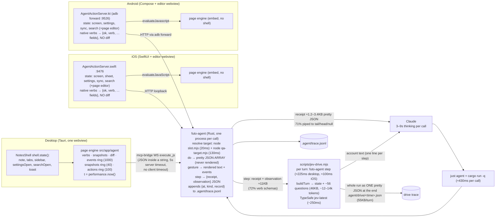

## 1. Current map

What each hop carries, measured on desktop (`measure.mjs`, 5 runs each, median):

| command | wall time (binary) | via `just agent` | output |
|---|---|---|---|
| `state` | 160 ms | ≈590 ms | 763 B pretty JSON |
| `notes` | 157 ms | 590 ms | 198 B |
| `doc` | 161 ms | — | 166 B (4-line note) |
| `actions` | 158 ms | — | 5.9 KB table / 16.1 KB JSON (75 verbs) |
| `elements` | 162 ms | — | 3.0 KB table / 7.9 KB JSON (24 rows) |
| `at` | 158 ms | — | 1.8 KB |
| `step` (observe only) | 163 ms | — | 11.1 KB: `actions` 7,956 B, `elements` 2,248 B, everything else ~800 B |

Every query costs about 157 ms, whatever its size. Of that, `node scripts/qa-target.mjs port`
takes 130 ms and `slot.mjs` takes 20 ms. The page itself and the WebSocket take under 10 ms.
Through `just agent`, the fixed cost is ≈590 ms, because `cargo run -q` spends ≈430 ms on its
freshness check every time. The transcripts show the same: an agent `do` took 1.0 s on average.

Receipt sizes by verb (`.agent/trace.jsonl`, successful calls, printed pretty the way the CLI
prints them): `Type` median 1,499 B (p90 3,413), `Select` 1,196 (p90 3,314), `Insert` 1,182,
`SetTitle` 2,641, `CreateFolder` 2,579, `Press` 1,506 (p90 4,494). All editor verbs together:
median 1,179 B (≈340 tokens), p90 2,268 B. A native receipt (`MoveNote`, `GoBack` on the phones)
is 115–160 B and says nothing about what changed.

Jev (`tool-eval/runs`):

| sweep | pass | app ms/turn (median) | Jev ms/turn (median) | input tokens/turn |
|---|---|---|---|---|
| jev-desktop-final | 18/20 | 225 | 250 | 11,824 |
| jev-desktop-v3 | 19/20 | 247 | 277 | 12,697 |
| jev-workflows-merged-5 | 19/20 | 181 | 200 | 10,064 |
| jev-ios-final | 17/20 | 100 (mean 619, from note-load waits) | 205 | 7,912 |

Drive traces show tokens per turn rising from about 6k on 09-21 to 12.7–14.1k on 09-24.

---
