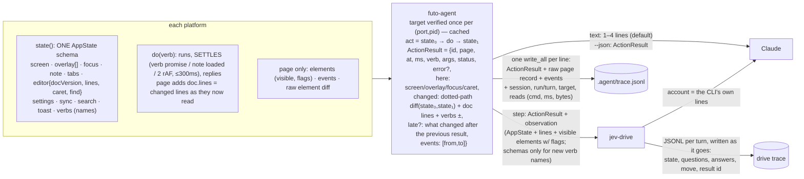

## 3. Proposed map

One shape for "the result of an action", `ActionResult`. The CLI builds it the same way for all
three platforms. Claude reads it as text lines, Jev reads it as JSON, and the trace keeps it in
full.



What the default text looks like. These lines are made up, but each uses fields the page already
has:

```text
#119 Type "  " → 200 · 9ms · editor:grocery list · caret L4:3
  L4 "  - [ ] coffee"
  note.dirty false→true
#38 OpenSettings → 200 · 212ms · overlay +dialog "Settings" · focus "Close settings"
  verbs +CloseSettings +SetTheme +SetLanguage +ToggleLanguageOptions … (+19)
#44 SetFindQuery {"query":""} → 200 · editor.find.query "the"→"" · editor.find.total 3→0
#40 PlaceCaret → 400 missing required argument "at" — takes {"at": integer, "docVersion": integer?}
```

That is about 100–250 bytes where there are now 1.2–3.4 KB: **roughly 10× fewer tokens for each
receipt**. The receipt carries the two things that currently need a second read (the lines, the
verbs), so a `do && doc` chain stops paying for itself.

### Minimal set of changes, and what each buys

| # | change | where | buys |
|---|---|---|---|
| C1 | Print `do` (and each `step` receipt) as the text lines above. Keep `{"json":true}` for the raw body. Include `args` and `ms`. | `main.rs` (one `render_result`, reused by gestures) | −90% receipt tokens. Ends the tail/head truncation (71% of `do` calls). Deletes jev-drive's `describeChanges` and `slimReceipt`: the account prints the CLI's own line. |
| C2 | Complete the page diff. (a) Snapshot the full page `state()`, including `editor.find` and `focused`, rather than `shell` alone. (b) Put the changed lines as they now read in `diff.doc.lines`. (c) Derive `overlay[]` and `focus` from elements (role dialog/menu/listbox/alertdialog, `aria-expanded`, `focused`). (d) Show an input's value beside its aria-label. (e) Add `checked` for native checkboxes. Remove the `editor` block and `selected` from receipts, and keep rect-only and doc-echo element changes out of the receipt (they stay in the trace). | `agentTrace.ts`, `agentInspector.ts`, `agentElements.ts` | Fixes the "no change" on `SetFindQuery`. Makes most `doc`/`actions`/`state` follow-up reads unnecessary (≈19% of actions were followed by one, ≈4.7 s of thinking each). |
| C3 | Settle in the page before the `after` snapshot. `OpenNote` returns a promise that resolves once the document is loaded. Every verb gets a flush plus 2 rAF, capped at about 300 ms. | page verbs, `recordDo` | Receipts complete the first time. Deletes the CLI `step` note-load poll (`main.rs:1578-1597`, and its 1.5 s cost for an empty note). `changedSinceLast` stays only as a rare safety net, also rendered on 202 receipts. |
| C4 | Cut the fixed cost. The `just agent` recipe runs `target/debug/futo-agent` when it is newer than its sources, and builds only otherwise. The qa-target verdict is cached in `.agent/` keyed by port+pid+process start time. A refusal is never cached, and a new pid always re-verifies (M24). The WS read gets a 10 s client timeout. | justfile, `main.rs` | ≈0.56 s per Claude call. ≈0.13 s per Jev step (about 20–25% of a desktop turn), twice on a press turn. A hung bridge fails fast instead of taking 60–180 s. |
| C5 | One AppState schema on all platforms. Native `state` adds `overlay` (sheet, modal from `modalUp`) and `focus`. Desktop adds `settings`/`sync`. Everyone adds `verbs` (names). For native verbs, the CLI diffs `state` before and after, generically, in Rust. That is one implementation, not one in Swift and one in Kotlin. | both `AgentActionServer`s, `NotesShell`, `main.rs` | Native receipts say what changed: 46 of 109 iOS turns currently get nothing. Same shape and vocabulary on all three platforms. |
| C6 | Jev observation and questions. Observation = AppState + lines + visible elements with flags. Answer options include `overlay`/`focus`, so "is the dropdown open" becomes a path. Drop `computed.overlay`. Fan argument questions out only over subjects the task names (no `mode@<every note>`). Skip arguments of verbs whose required values have no candidate. Send schemas only for new verb names. | `jev-drive.mjs`, `observe` | Estimated 46 KB → ≈25 KB per request (≈−45% tokens), from the table in F5. Jev can finally see menus, dropdowns and focus. Must be re-gated on the sweeps. |
| C7 | Joinable traces. The page's `t` becomes epoch ms (`performance.timeOrigin + now`), and `timeOrigin` doubles as the page-instance id carried on every result. A trace line = `{at, session, run, turn, target, page, cmd, args, status, ms, result, events}`, written with one `write_all`. Reads are logged as `{cmd, ms, bytes}`. Drive traces become JSONL per turn with `at` and `questions`, keep verb schemas out, and write on every exit path. | `agentTrace.ts`, `main.rs`, `jev-drive.mjs` | Any Jev turn joins to its CLI line and to the page's action and events. A failing run leaves a trace. No corrupt lines. |

To delete: the `editor` block in editor-verb receipts (`agentInspector.ts:176`); `selected`; the
`step` load loop; `computed.overlay`; `slimReceipt`; `describeChanges`; `state`'s snapshot id;
the stale Android-`notes` sentence (commands.md:42) and the page's stale refusal text
(`agentInspector.ts:589`). Optionally `elements {"changed":true}`: receipts replace it, and no
transcript used it.

Out of scope, recorded for later: `Press` with modifiers (F8). It is needed to reproduce
shortcut bugs such as the undo scenario, but it is a new verb capability, not part of the result
pipeline.

---
